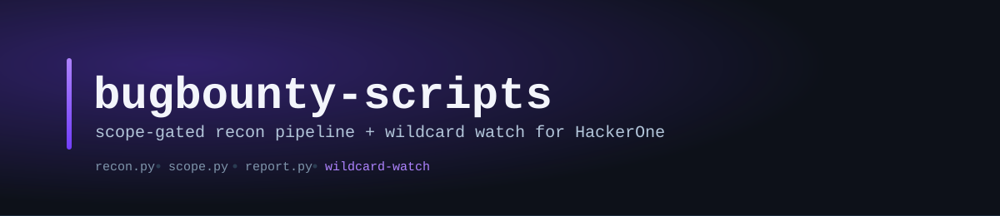

<p>
  
  
  
  
</p>

Toolkit pessoal pra bug bounty: do recon automatizado até o aviso no
Discord quando aparece um programa novo que vale a pena — tudo amarrado
ao escopo real de cada programa, porque "achei um subdomínio" não vale
nada se não for exatamente o que o programa autorizou.

## O que tem aqui

- **[`recon.py`](recon.py)** — pipeline de recon em 9 fases (subdomínio,
  DNS, portas, probe, crawl, fuzz, vuln scan), sempre filtrado pelo
  escopo do programa, em paralelo onde dá pra ser rápido
- **[`scope.py`](scope.py)** — o gate de segurança: decide o que pode e
  não pode ser tocado, a partir de um `programs/<nome>.yaml`
- **[`report.py`](report.py)** — gera rascunho de relatório já na
  estrutura que o HackerOne espera
- **[`setup_kali.sh`](setup_kali.sh)** — resolve todas as dependências
  numa VM nova, idempotente
- **[`wildcard-watch-railway/`](wildcard-watch-railway/)** — serviço que
  roda 24/7 na nuvem (Railway) vasculhando o diretório do HackerOne atrás
  de programas Bounty com escopo wildcard, e avisa no Discord + Telegram
  assim que acha um novo — ver [README próprio](wildcard-watch-railway/README.md)

## Regra de ouro: escopo primeiro

Nenhum script ataca nada sem um arquivo `programs/<nome>.yaml` descrevendo
o que está **dentro** e **fora** do escopo, copiado da política real do
programa no HackerOne. É esse arquivo que decide o que pode ser testado —
trate-o como a autorização por escrito do programa.

```bash
cp programs/_template.yaml programs/minha-empresa.yaml
# edite in_scope/out_of_scope/rules com os dados da página de política
python3 scope.py programs/minha-empresa.yaml show
```

Antes de testar qualquer programa, leia a política completa dele
(`policy_url`): tipos de teste proibidos, rate limit exigido, prazo de
disclosure, ativos de terceiros excluídos. O arquivo de escopo é um
resumo para os scripts, não substitui a leitura da política.

## Instalação

**Numa VM Kali nova**, rode o setup automático (apt + go install, idempotente):
```bash
./setup_kali.sh
```

**Manual** (qualquer Linux com Go):
```bash
pip3 install -r requirements.txt
```

Todo script detecta ferramenta ausente e avisa como instalar, sem travar
o resto do pipeline. O probe de hosts vivos tem fallback em `requests`
puro e não exige nenhum binário externo.

| Ferramenta | Usada em | Instalar |
|---|---|---|
| nmap | port scan detalhado (`--ports`) | `apt install nmap` |
| naabu | port discovery rápido (`--ports`) | `go install github.com/projectdiscovery/naabu/v2/cmd/naabu@latest` |
| subfinder, assetfinder | subdomínios (fase 1) | `go install github.com/projectdiscovery/subfinder/v2/cmd/subfinder@latest` / `go install github.com/tomnomnom/assetfinder@latest` |
| amass | subdomínios, só com `--deep` | `go install github.com/owasp-amass/amass/v4/cmd/amass@latest` |
| dnsx | resolução DNS (fase 3) | `go install github.com/projectdiscovery/dnsx/cmd/dnsx@latest` |
| gau | urls históricas (fase 2) | `go install github.com/lc/gau/v2/cmd/gau@latest` |
| katana | crawling (`--crawl`) | `go install github.com/projectdiscovery/katana/cmd/katana@latest` |
| ffuf | content discovery (`--fuzz`) | `go install github.com/ffuf/ffuf/v2@latest` |
| nuclei | vuln scan (`--nuclei`) | `go install github.com/projectdiscovery/nuclei/v3/cmd/nuclei@latest` |
| notify | alertas no Discord/Telegram | `go install github.com/projectdiscovery/notify/cmd/notify@latest` |

> Atenção: existe um comando `httpx` no PATH que NÃO é o scanner da
> ProjectDiscovery — é a CLI do cliente HTTP Python `httpx` (mesmo nome,
> ferramenta diferente). `setup_kali.sh` já instala o real e renomeia pra
> `pdhttpx`, que é o nome que `recon.py` procura; se instalar manualmente,
> faça `mv ~/go/bin/httpx ~/go/bin/pdhttpx` depois do `go install`.

`amass` fica fora do default porque é a fonte mais lenta de longe (passa
de 1-2min por domínio mesmo em modo passivo) pro ganho que dá sobre
crt.sh+subfinder+assetfinder — use `--deep` quando quiser mesmo assim.

## Uso

**Recon rápido (fases passivas + probe, sem ações ativas):**
```bash
python3 recon.py programs/minha-empresa.yaml
```

**Recon completo (todas as fases ativas, se o escopo permitir cada uma):**
```bash
python3 recon.py programs/minha-empresa.yaml --deep --ports --crawl --nuclei --confirm
```

Flags:
- `--deep` — inclui `amass -passive` na fase 1 (mais lento, mais cobertura)
- `--ports` — port discovery (naabu) + port scan detalhado (nmap -sV)
- `--crawl` — crawling (katana) nos hosts vivos
- `--fuzz --wordlist <path>` — content discovery (ffuf); sem `--wordlist`
  procura SecLists/dirb instalados no sistema
- `--nuclei` — vuln scan com templates (CVEs, exposures, misconfig)
- `--confirm` — obrigatório pra qualquer uma das fases ativas acima rodar
- `--no-zip` — não compacta o resultado no final (por padrão, compacta)

Cada rodada grava em `output/<programa>/<timestamp>/` e termina gerando
`output/<programa>/<timestamp>.zip` — é esse único arquivo que você sobe
pra análise depois. Dentro dele:
- `subdomains.txt` — subdomínios descobertos e já filtrados por escopo
- `historical_urls.txt` — urls históricas (gau), se disponível
- `resolved.txt` — hosts que resolvem DNS
- `naabu.txt` — pares host:porta abertos, se `--ports`
- `probe.jsonl` — hosts/portas vivos, título, status code, tech
- `crawled_urls.txt` — urls encontradas pelo crawler, se `--crawl`
- `ffuf_*.json` — content discovery por host, se `--fuzz`
- `nmap.xml` — se `--ports`
- `nuclei.jsonl` — se `--nuclei`

**Registrar um achado:**
```bash
python3 report.py new programs/minha-empresa.yaml --title "IDOR em /api/orders/:id"
python3 report.py list programs/minha-empresa.yaml
```
Cria um rascunho em Markdown em `findings/<programa>/` com a estrutura
que o HackerOne espera (resumo, passos, evidência, impacto, remediação).
Preencha e cole no formulário de submissão do programa.

## Wildcard Watch

Um robozinho que mora no Railway, acorda a cada 6h, abre o diretório
público de programas do HackerOne, filtra quem é **Bounty** + tem
**escopo wildcard** + resposta ≥70%, e só te incomoda quando aparece algo
genuinamente novo — sem repetir aviso do que você já viu. Mensagem no
estilo:

```
👁️ Nyarlathotep whispers...

🎯 Vercel
🌐 2 wildcard domains
💰 $50 – $10,000
🔥 Good target

🔗 https://hackerone.com/vercel
```

Roda inteiramente na nuvem — seu computador pode ficar desligado, não
depende da sua VM estar ligada. Detalhes de deploy em
[`wildcard-watch-railway/README.md`](wildcard-watch-railway/README.md).

## Por que isso é só o esqueleto

Isso automatiza a parte repetitiva (descobrir superfície, ver o que está
de pé, rodar templates conhecidos). A parte que realmente encontra bugs
que pagam — entender a lógica da aplicação, testar fluxos de negócio,
IDOR, auth bypass, lógica de pagamento — é manual e fica com Burp Suite
+ você lendo a aplicação. Trate os scripts como triagem inicial, não como
o processo completo.

`programs/*.yaml`, `findings/` e `output/` estão no `.gitignore`: eles
guardam nomes de empresas e dados de recon reais, então ficam só
localmente a menos que você decida publicar algo deliberadamente.
